<div align="center">



<br/>


</div>

Aplicación de consola en Python para **administrar alumnos, cursos y matrículas** de un colegio sobre una base de datos **SQLite**. Ejercicio de práctica de Python con bases de datos.

## 🗄️ Modelo de datos

| Tabla | Campos |
|---|---|
| `alumnos` | `dni` (clave), `nombre`, `apellido`, `estado` (activo/retirado) |
| `cursos` | `id`, `nombre` — viene cargada con álgebra, trigonometría, programación y aritmética |
| `matriculas` | `id`, `dni`, `curso_id` |

## 🖥️ Menú

```
1- inserte un nuevo alumno.
2- retirar un alumno.
3- matricular un alumno al curso...
4- cursos y alumnos en nuestra base de dato.
5- salir de la app.
```

## 🚀 Cómo usarlo

```bash
python "creacion de la DB.py"           # crea tablaDB.db con las tablas y los cursos
python sistema_adeministracion_colegio.py
```

## ✅ Estado

Todas las opciones del menú funcionan y validan los datos:

| Opción | Qué hace |
|---|---|
| Insertar alumno | Registra el alumno y avisa si el DNI ya existe |
| Retirar alumno | Marca al alumno como retirado y guarda el cambio |
| Matricular alumno | Verifica que el alumno esté activo y que el curso exista, y entrega el código de matrícula |
| Listar cursos y alumnos | Muestra cada curso con sus alumnos y los alumnos sin matrícula |

Si se escribe algo que no es un número donde corresponde uno, el programa vuelve a preguntar en vez de cerrarse.

```
├── sistema_adeministracion_colegio.py   ← aplicación y menú
├── DB.py                                ← práctica de consultas SQLite (crear, insertar, actualizar)
├── creacion de la DB.py                 ← crea las tablas
├── Ambiente_pruebas.py                  ← pruebas de str.join
├── tablaDB.db                           ← base SQLite
└── assets/                              ← banner de este README
```

---

<div align="center">

Hecho por **[Marcelo Reinoso](https://github.com/Monokhan)** · datos aplicados a minería e infraestructura

</div>
